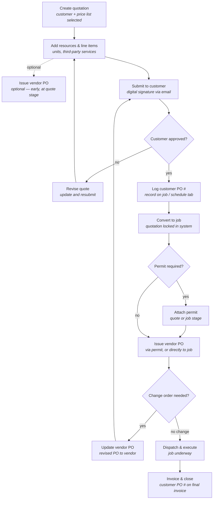

# Quote → Job → Invoice, with permits and both PO types

Transcription of the workflow diagram **Brian Petros** sent on **2026-09-05**. The original is a
raster image; it was pasted into a working session rather than supplied as a file, so **this
markdown is the vault's copy of record** — every box, edge, legend entry and panel item below is
taken from the image. The interpretation and what it settles live in
[../../decisions/2026-09-05-po-types-and-quote-to-invoice-workflow.md](../../decisions/2026-09-05-po-types-and-quote-to-invoice-workflow.md).

Brian's covering text:

> "Here is Quote to Job to Invoice workflow (including Permits and both types of POs)...
>
> **PO Type 1 (Customer PO):** Simple and passive on our end... the customer sends it, we log it,
> we put it on the invoice. It shows up at the moment the customer approves the quote, and again
> at invoicing.
>
> **PO Type 2 (Vendor PO):** This is the full 7-step procurement cycle... we are the buyer, the
> vendor is the seller. It kicks off when the Quote is created and/or after the Job is created
> (when third-party services are involved), and loops again if there's a change order."

## The flow

**Node styling in the original**, which carries meaning — see the legend:

| Box | Fill | Meaning |
| --- | --- | --- |
| Create quotation · Invoice & close | grey | start / end |
| Add resources · Submit to customer · Convert to job | blue | main path |
| Log customer PO # | **green** | Type 1 PO — customer sends us their PO # |
| Issue vendor PO (both) · Update vendor PO | **coral / pink** | Type 2 PO — we send a PO to our vendor |
| Customer approved? · Permit required? · Change order needed? | **amber** | decision point |
| Attach permit | **purple** | permit — must precede vendor PO when required |
| Revise quote · Update vendor PO | pink | revision / exception path |
| Dispatch & execute | green | — |

## Legend, verbatim

- 🟩 **Type 1 PO** — customer sends us their PO #
- 🟥 **Type 2 PO** — we send a PO to our vendor
- 🟨 **Decision point**
- 🟪 **Permit — must precede vendor PO when required**
- 🟪 **Revision / exception path**
- ┄┄► **Dashed coral arrow** — vendor PO issued early (optional, at quote stage)

## Purchase Order Details panel

### Type 1 — Customer PO

1. **Customer provides their PO #** — their internal authorization for the job
2. **Log it on the job (schedule tab)** — no internal reporting required
3. **Reference it on our invoice** — helps the customer process payment

### Type 2 — Vendor PO (7-step workflow)

1. **Requisition** — dept. submits request for goods or services
2. **Approval** — management reviews and checks budget
3. **PO creation & sending** — formal PO issued and sent to the vendor
4. **Vendor acceptance** — PO becomes a legally binding contract
5. **Fulfillment** — vendor ships goods or performs services
6. **Goods receipt** — we confirm delivery matches the PO
7. **Three-way match & payment** — AP matches PO + invoice + receipt → pay

## Notes on reading it

- The customer PO appears at **exactly two points**: *Log customer PO #* right after approval, and
  *Invoice & close* (*"customer PO # on final invoice"*). It is never a quotation field.
- The vendor PO appears at **three**: the optional early dashed path off *Add resources & line
  items*, the main *Issue vendor PO* after conversion, and *Update vendor PO* on a change order.
- *Issue vendor PO* is reachable **either** through *Attach permit* (permit required) **or**
  directly from the *Permit required? → no* edge — hence *"via permit, or directly to job"*.
- **There is no permit-approval step.** *Attach permit* is the permit record existing; the PO
  is then raised *via* it. The diagram therefore says nothing about whether a permit may be
  **approved** without a PO — the built gate (approval blocked until a PO is linked) is neither
  confirmed nor contradicted here.
- The change-order loop returns to **Submit to customer**, not to the PO — a revised vendor PO
  re-enters the customer approval cycle.
- **No lost-quote path exists on the diagram**, which is why Ryan Adams' quote-lost → PO-closed
  rule stays unconfirmed (`../../vendors-agencies/gaps.md`).
- **No standalone / unanchored PO path exists**, which is why Joe Schacatano's third PO level
  stays unconfirmed — and why Brian's separate RCS message matters
  (`../../accounting/gaps.md` → *Invoicing a travel permit that is not tied to a job*).
